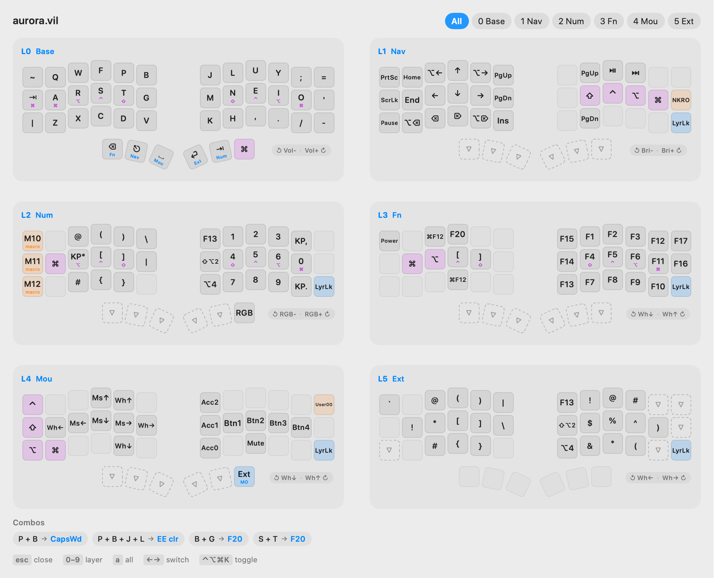

# Vial Helper

Menu-bar app for macOS that shows the keymap of your Vial-configured split keyboard
(by default a splitkb Aurora Corne) as a floating overlay.



- Lives in the menu bar (no Dock icon). Left-click the keyboard icon to toggle the overlay,
  right-click for the menu (Show, Reload Keymap, Open .vil File…, Reveal in Finder, Settings, Quit).
- Global shortcut toggles the overlay from anywhere (default `⌃⌥⌘K`, change it in Settings).
- Reads a Vial export (`.vil`); path is configurable, default `~/aurora.vil`.
  The file is re-read automatically whenever it changes on disk.
- Settings → Keymap source → "Keyboard when connected" (the default): the keymap, encoders, combos, tap dances,
  key overrides and QMK settings are read live from the keyboard over the Vial protocol (read-only, under half a
  second), on connect and again in the background each time the overlay opens, so edits made in the Vial GUI show
  up without re-exporting. The header shows "<keyboard> · live" instead of the file name. The `.vil` is used while
  the keyboard is away or a read fails.
- Overlay shows all non-empty layers at once (layers with only transparent/unassigned keys are hidden); press `0`–`9` to zoom into a layer, `a` for all,
  `←`/`→` to cycle, `Esc` to close. Clicking anywhere else also closes it.
- Shows mod-taps (hold modifier under the tap key), layer-taps, combos and encoder bindings.
  Layer names from Settings replace "L1"-style legends on layer keys and in the layer chips.
  Settings → Encoders picks which half's encoder to draw (Vial exports a slot per half even if unused).
- Hold-alone actions (firmware with `hold_alone.c`): set Settings → Hold-alone actions → Config layer
  (e.g. "Last layer"). That layer is hidden and its keys show in teal (`◔`) at the top right of the
  layer-tap / mod-tap keys they belong to; bindings the firmware can never send are flagged below the keymap.
- Custom keycodes (`USER00`… / `QK_KB_0`…) show the names from Settings → Custom keycode names
  (comma-separated, or "Load from vial.json…" to take `customKeycodes[].shortName`); unnamed ones show as `U0`, `U1`…
- Below the keymap: enabled key overrides (trigger + mods → replacement, with a layer restriction if any) and a
  line with the tap-hold QMK settings stored in the `.vil` (tapping term, Permissive Hold, Chordal Hold, Flow Tap…).
- Tap-hold keys exempt from Chordal Hold's same-hand rule are marked with a small `✱` (once the set is known).
- Keyboard link (raw HID, firmware with the `vial_full` keymap's `host_hid.c`, see
  [egno/vial-qmk](https://github.com/egno/vial-qmk/tree/vial/keyboards/splitkb/aurora/corne/keymaps/vial_full)): the menu shows whether
  the keyboard is connected plus its firmware commit and build date. With Settings → "Show clock and
  input source on the keyboard OLED" (on by default) the right OLED shows the time and the active
  input source ("EN", "RU"); the text is cleared on quit and expires by itself after 90 s otherwise.
  The device is opened shared, so the Vial GUI keeps working alongside.
- Live data over the same link (each part needs firmware that answers the command; older builds are
  simply left alone until the next connect):
  - Misfire heatmap (`0xF3`): base-layer mod-taps are tinted by how often their tap/hold decision was
    corrected with Backspace; zoomed into the base layer the counts show too (bottom left held by
    mistake, bottom right tapped by mistake). The tint is relative between keys, the counters live in
    the keyboard's RAM and "tapped" includes ordinary typos. `m` hides/shows it; the menu has
    "Reset Misfire Counters".
  - Active layers (`0xF4`, polled while the overlay is open): outlined cards and dotted chips for the
    layers that are on, a lock for Layer Lock, and chips for trainer / Caps Word / Caps Lock / one-shot
    mods and layer. With a single layer zoomed, the overlay switches to the highest active layer as it
    changes (Settings → "Follow the active layer", on by default).
  - Chordal Hold exemptions (`0xF6`) fill the `✱` markers, and the tap-hold line shows Chordal Hold and
    the Flow Tap term as the keyboard applies them now.
  - Trainer results (`0xF5`): every finished trainer session is appended to
    `~/Library/Application Support/VialHelper/trainer-history.json` (noticed within ~5 s, also with the
    overlay closed). Menu → "Trainer History…" shows speed and accuracy over sessions, misses by kind
    and the slowest / least accurate characters. Per-character numbers in a record are what was added
    since the previous record of the same keyboard power cycle (see `TrainerHistory.swift`).

## Build

Requires the Swift toolchain (Command Line Tools are enough, no Xcode needed), macOS 13+.

```sh
./build.sh            # -> build/VialHelper.app
./build.sh --run      # build and launch
./build.sh --install  # build and copy to /Applications (needed for "Launch at login")
```

## Debug

```sh
swift run VialHelper --show                     # launch with the overlay already open
swift run VialHelper --render out.png           # render the overlay to a PNG and exit
swift run VialHelper --render out.png --layer 1 # render a single layer
swift run VialHelper --render out.png --chordal-exempt 303,304,305  # mark keys (row*100+col) as Chordal Hold exempt
swift run VialHelper --selftest                 # open overlay, exercise key handling, exit 0/1
swift run VialHelper --settings                 # launch with the Settings window open
swift run VialHelper --hid-version              # print firmware version, build date, commit and exit
swift run VialHelper --hid-status "12:34|EN"    # send one OLED status text (rows split by "|"), print the reply
swift run VialHelper --hid-status "" [--ttl N]  # empty text clears it; --ttl sets the lifetime in seconds (default 90)
swift run VialHelper --hid-raw "f0 02"          # send raw hex bytes as one report, print the reply
swift run VialHelper --vial-dump out.json       # read the keymap live over the Vial protocol, write it as .vil-like JSON
swift run VialHelper --vial-diff [file.vil]     # compare the live read with a .vil (default: the configured one), list every difference
swift run VialHelper --render out.png --live    # render from the live read (falls back to the file if it fails)
                                                # modifiers: --vial-timeout 0.00001 (force a failure), --vial-no-definition
swift run VialHelper --hid-misfire              # print the keyboard's misfire table (and it as an --inject-misfires argument)
swift run VialHelper --hid-live                 # ask 0xF4 / 0xF5 / 0xF6 once and print what comes back
swift run VialHelper --live-probe 5             # run the live polling for 5 s, print the request count per command
swift run VialHelper --live-selftest            # report parser + trainer history tests only (also part of --selftest)
swift run VialHelper --render out.png --fake-misfires            # or --inject-misfires "hex;hex;…" (0xF3 replies)
swift run VialHelper --render out.png --inject-state "f4 00 …"   # a 0xF4 reply: active / locked layers, indicators
swift run VialHelper --render out.png --inject-taphold "f6 00 …" # a 0xF6 reply: Chordal Hold exemptions, tap-hold line
swift run VialHelper --render-trainer out.png --fake-trainer     # Trainer History window (or --trainer-history file.json)
```

## Toolchain note

The project builds with the Command Line Tools alone. On the macOS 27 SDK SwiftUI's `@State`
is a compiler macro whose plugin ships only with Xcode, so views keep transient state in
`ObservableObject`s (`@ObservedObject`) instead of `@State`.

## License

[MIT](LICENSE)
